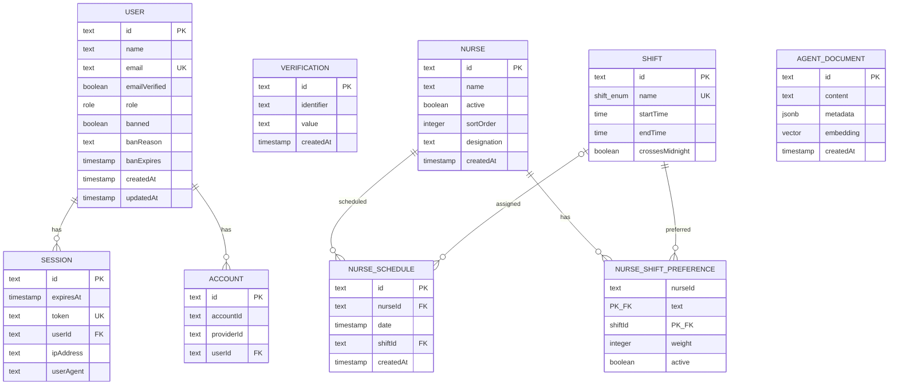

# Duty Roster Database ERD

The application uses PostgreSQL with Drizzle ORM.

## Relationships

- `nurse_schedule` stores one assignment per nurse per day.
- A null `shiftId` in `nurse_schedule` represents an OFF day.
- `nurse_shift_preference` is a many-to-many table that stores each nurse's preference weight for a shift.
- `agent_document` stores text, metadata, and vector embeddings for AI/document retrieval.
- `user`, `session`, `account`, and `verification` are managed by Better-Auth.
